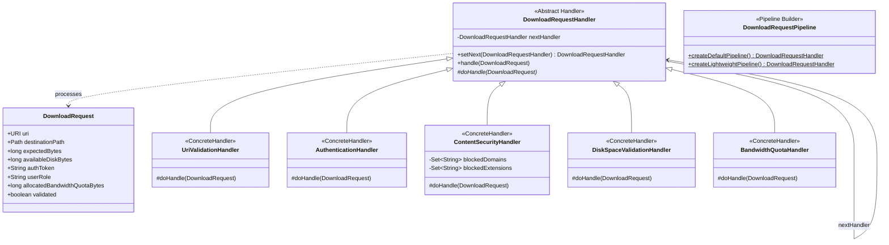

# Патерн Chain of Responsibility (Ланцюжок відповідальностей) у NetRetriever

Головна ідея патерну **Chain of Responsibility** — **уникнути жорсткого зв'язування відправника запиту з його отримувачами**, надаючи кільком об'єктам можливість послідовно обробити цей запит. Отримувачі шикуються в ланцюжок, і запит передається вздовж нього, доки кожен крок не буде успішно виконано або відхилено.

---

### 1. Проблема без патерну

Перед початком завантаження будь-якого файлу система повинна виконати комплекс попередніх перевірок (pre-flight checks):
1. **Валідація URI:** Перевірити коректність формату адреси та підтримку протоколу (HTTP, HTTPS, FTP, S3).
2. **Автентифікація:** Перевірити валідність токена авторизації для доступу до захищених ресурсів.
3. **Безпека вмісту:** Перевірити хост на відсутність у чорному списку шкідливих сайтів та блокувати небезпечні розширення (`.exe`, `.bat`).
4. **Місце на диску:** Переконатися, що на цільовому носії достатньо вільного місця для розміщення файлу.
5. **Квота пропускної здатності:** Перевірити, чи не перевищує розмір файлу залишок квоти користувача.

Без патерну ланцюжка відповідальностей цей код перетворюється на громіздкий моноліт із вкладених умовних операторів (`if-else`) у сервісі завантаження. Будь-яка зміна правил перевірки (додавання нових перевірок, зміна їх черговості) призводить до порушення принципів **Open/Closed Principle (OCP)** та **Single Responsibility Principle (SRP)**.

---

### 2. Архітектурне рішення з патерном Chain of Responsibility

Кожна перевірка інкапсулюється в окремий клас-обробник, успадкований від абстрактного класу [`DownloadRequestHandler`](./DownloadRequestHandler.java). Обробники пов'язуються у ланцюжок за допомогою посилання на наступника (`nextHandler`):



---

### 3. Структура класів

* [`DownloadRequest`](./DownloadRequest.java) — модель запиту (контекст), що містить усі вхідні параметри для перевірки (URI, цільовий шлях, розміри, токени).
* [`DownloadValidationException`](./DownloadValidationException.java) — виняток, який генерується будь-якою ланкою ланцюжка при виявленні помилки валідації.
* [`DownloadRequestHandler`](./DownloadRequestHandler.java) — базовий абстрактний обробник із шаблоном передачі керування наступній ланці (`handle()` -> `doHandle()` -> `nextHandler.handle()`).
* **Конкретні обробники:**
  * [`UriValidationHandler`](./UriValidationHandler.java) — валідує синтаксис URI та наявність дозволеної схеми (`http`, `https`, `ftp`, `s3`).
  * [`AuthenticationHandler`](./AuthenticationHandler.java) — перевіряє наявність та валідність токена автентифікації.
  * [`ContentSecurityHandler`](./ContentSecurityHandler.java) — сканує домен за чорним списком та блокує небезпечні розширення файлів для стандартних користувачів.
  * [`DiskSpaceValidationHandler`](./DiskSpaceValidationHandler.java) — порівнює очікуваний розмір завантаження з доступним дисковим простором.
  * [`BandwidthQuotaHandler`](./BandwidthQuotaHandler.java) — перевіряє ліміт виділеної пропускної здатності.
* [`DownloadRequestPipeline`](./DownloadRequestPipeline.java) — фабрика-будівник готових типових конвеєрів (стандартний повний та спрощений).

---

### 4. Приклад використання

```java
// Створення конвеєра за допомогою фабрики
DownloadRequestHandler pipeline = DownloadRequestPipeline.createDefaultPipeline();

// Створення запиту на завантаження
DownloadRequest request = DownloadRequest.builder()
        .uri(URI.create("https://releases.ubuntu.com/noble/ubuntu-24.04-desktop-amd64.iso"))
        .destinationPath(Path.of("/downloads/ubuntu.iso"))
        .expectedBytes(5_000_000_000L)
        .availableDiskBytes(20_000_000_000L)
        .authToken("BEARER-VALID-TOKEN")
        .userRole("USER")
        .allocatedBandwidthQuotaBytes(10_000_000_000L)
        .build();

// Проходження крізь усі ланки ланцюжка
try {
    pipeline.handle(request);
    System.out.println("Запит успішно валідовано, починаємо завантаження!");
} catch (DownloadValidationException ex) {
    System.err.println("Валідація відхилена ланкою: " + ex.getHandlerName() + ", причина: " + ex.getMessage());
}
```

---

### 5. Відповідність принципам архітектури

* **Single Responsibility Principle (SRP):** Кожен клас-обробник відповідає виключно за один аспект валідації (диск, безпека, автентифікація, мережа).
* **Open/Closed Principle (OCP):** Додавання нових перевірок (наприклад, сканування антивірусом або перевірка геолокації IP) відбувається додаванням нового класу `DownloadRequestHandler` без зміни наявних обробників.
* **Liskov Substitution Principle (LSP):** Будь-який обробник взаємозамінний у ланцюжку і не ламає роботу інших ланок.
* **Low Coupling (GRASP):** Відправник запиту знає лише про інтерфейс обробника (`handle()`), не будучи прив'язаним до конкретних типів та кількості кроків перевірки.
