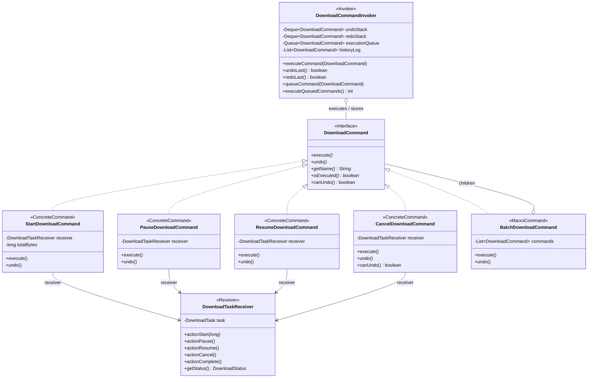

# Патерн Command (Команда) у NetRetriever

Головна ідея патерну **Command** — **інкапсулювати запит (дію) як самостійний об'єкт**, що дозволяє параметризувати клієнтські об'єкти різними операціями, ставити запити у чергу, логувати історію виконання та підтримувати багаторівневе скасування (Undo) і повторення (Redo).

---

### 1. Проблема без патерну

У менеджері завантажень керування життєвим циклом завдань ([`DownloadTask`](../../../downloadtask/DownloadTask.java)) включає операції запуску, призупинення, відновлення, скасування та пакетного виконання:
1. **Жорстке зв'язування:** Клієнти (CLI, REST-контролери, фонові таймери) безпосередньо викликають методи доменних сутностей, знаючи всі деталі переходів станів та їх параметри.
2. **Відсутність механізму скасування (Undo/Redo):** Якщо користувач помилково запустив або призупинив групу завантажень, повернути попередній стан системи без збереження історії дій надзвичайно складно.
3. **Черги та відкладене виконання:** Неможливо гнучко планувати дії у чергу або передавати їх між потоками як окремі одиниці роботи.
4. **Атомарність групових дій:** При виконанні макро-команд (наприклад, одночасний старт 10 завдань) відсутній єдиний механізм відкату (rollback), якщо одне із завдань зазнало збою.

---

### 2. Архітектурне рішення з патерном Command

Патерн розділяє систему на такі ключові ролі:
* **Command Interface:** [`DownloadCommand`](./DownloadCommand.java) визначає єдиний контракт (`execute()`, `undo()`, `canUndo()`, `getName()`).
* **Receiver:** [`DownloadTaskReceiver`](./DownloadTaskReceiver.java) інкапсулює реальні бізнес-операції над доменною сутністю [`DownloadTask`](../../../downloadtask/DownloadTask.java).
* **Concrete Commands:** [`StartDownloadCommand`](./StartDownloadCommand.java), [`PauseDownloadCommand`](./PauseDownloadCommand.java), [`ResumeDownloadCommand`](./ResumeDownloadCommand.java), [`CancelDownloadCommand`](./CancelDownloadCommand.java), [`BatchDownloadCommand`](./BatchDownloadCommand.java).
* **Invoker:** [`DownloadCommandInvoker`](./DownloadCommandInvoker.java) управляє стеками `Undo` і `Redo`, чергою відкладеного виконання та аудит-журналом.



---

### 3. Структура класів

* [`DownloadCommand`](./DownloadCommand.java) — базовий інтерфейс команди з підтримкою транзакційного відкату.
* [`DownloadTaskReceiver`](./DownloadTaskReceiver.java) — отримувач дії, що знає, як виконати операцію над `DownloadTask`.
* **Конкретні команди:**
  * [`StartDownloadCommand`](./StartDownloadCommand.java) — переводить завдання зі стану `CREATED`/`PAUSED` у `DOWNLOADING`. Під час `undo()` скасовує або призупиняє операцію.
  * [`PauseDownloadCommand`](./PauseDownloadCommand.java) — призупиняє активне завантаження; `undo()` відновлює його.
  * [`ResumeDownloadCommand`](./ResumeDownloadCommand.java) — відновлює завантаження з точки зупинки; `undo()` знову призупиняє його.
  * [`CancelDownloadCommand`](./CancelDownloadCommand.java) — остаточно скасовує завдання (незворотна дія, `canUndo() == false`).
  * [`BatchDownloadCommand`](./BatchDownloadCommand.java) — макро-команда, що виконує групу дій послідовно із забезпеченням атомарності: якщо одна з підкоманд завершується помилкою, усі попередньо виконані команди автоматично відкочуються у зворотному порядку.
* [`DownloadCommandInvoker`](./DownloadCommandInvoker.java) — диспетчер команд, що забезпечує виконання, багаторівневий Undo/Redo та чергу FIFO.

---

### 4. Приклад використання

```java
DownloadTask task = new DownloadTask("https://example.org/film.mkv", "film.mkv", "/downloads");
DownloadTaskReceiver receiver = new DownloadTaskReceiver(task);
DownloadCommandInvoker invoker = new DownloadCommandInvoker();

// 1. Виконання команди запуску
DownloadCommand startCmd = new StartDownloadCommand(receiver, 1_500_000_000L);
invoker.executeCommand(startCmd);
// task.getStatus() == DOWNLOADING

// 2. Скасування запуску (Undo)
invoker.undoLast();
// task.getStatus() повернено до CANCELED / призупинено

// 3. Повторення дії (Redo)
invoker.redoLast();
// task.getStatus() == DOWNLOADING

// 4. Пакетна макро-команда
DownloadCommand batch = new BatchDownloadCommand("Group Pause", List.of(
        new PauseDownloadCommand(receiver)
));
invoker.executeCommand(batch);
```

---

### 5. Відповідність принципам архітектури

* **Single Responsibility Principle (SRP):** Кожна команда фокусується виключно на прив'язці конкретної дії до отримувача.
* **Open/Closed Principle (OCP):** Нові типи команд (наприклад, `PrioritizeDownloadCommand`, `ScheduleDownloadCommand`) додаються без змін у клієнтський код чи інвокер.
* **Command / Controller (GRASP):** `DownloadCommandInvoker` бере на себе роль контролера життєвого циклу запитів, забезпечуючи низьку зв'язність між інтерфейсом та бізнес-логікою.
