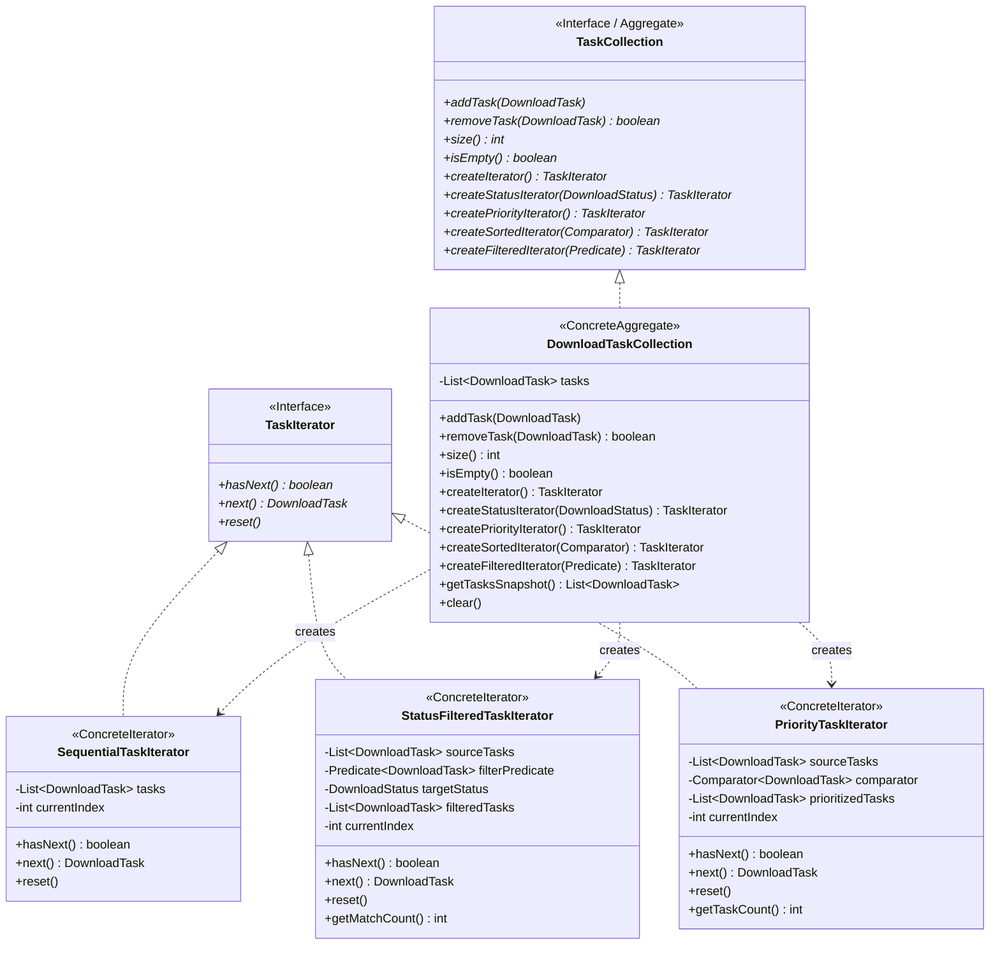

# Патерн Iterator (Ітератор) у NetRetriever

Головна ідея патерну **Iterator** — **надати послідовний доступ до елементів складеного об'єкта (колекції/агрегату), не розкриваючи його внутрішньої структури та представлення**.

---

### 1. Проблема без патерну

У системі завантаження файлів клієнтські компоненти (UI черги, планувальник потоків, статистика) постійно оперують наборами завдань ([`DownloadTask`](../../../downloadtask/DownloadTask.java)):
1. **Розкриття внутрішнього представлення:** Клієнти змушені напряму взаємодіяти з конкретними структурами даних (`ArrayList`, `LinkedList`, масиви), знаючи їхні індекси або внутрішню структуру вузлів.
2. **Неможливість різних стратегій обходу:** Потрібно обходити чергу завдань у різний спосіб:
   * Послідовно за порядком додавання.
   * Фільтруючи лише активні завантаження (`DOWNLOADING`), призупинені (`PAUSED`) або збійні (`ERROR`).
   * За пріоритетом (найбільші файли першими) без зміни вихідного порядку елементів у колекції.
3. **Порушення Single Responsibility Principle (SRP):** Якщо додати логіку фільтрації, сортування та стану обходу безпосередньо в клас колекції, він стане надмірно перевантаженим обов'язками.

---

### 2. Архітектурне рішення з патерном Iterator

Патерн виносить логіку обходу та поточний стан ітерації в окремі класи-ітератори, пов'язані з колекцією через інтерфейси:



---

### 3. Структура класів

* [`TaskIterator`](./TaskIterator.java) — цільовий інтерфейс ітератора з методами `hasNext()`, `next()`, `reset()`.
* [`TaskCollection`](./TaskCollection.java) — інтерфейс агрегату, що декларує фабричні методи створення спеціалізованих ітераторів.
* [`DownloadTaskCollection`](./DownloadTaskCollection.java) — конкретний агрегат, що інкапсулює список `DownloadTask`.
* **Конкретні ітератори:**
  * [`SequentialTaskIterator`](./SequentialTaskIterator.java) — послідовний обхід у порядку додавання.
  * [`StatusFilteredTaskIterator`](./StatusFilteredTaskIterator.java) — обхід лише тих завдань, які відповідають певному статусу (`DownloadStatus`) або кастомному предикату.
  * [`PriorityTaskIterator`](./PriorityTaskIterator.java) — обхід завдань у пріоритетному порядку (за замовчуванням — за спаданням розміру файлу, або за переданим `Comparator`), не змінюючи порядку елементів в основній колекції.

---

### 4. Приклад використання

```java
TaskCollection collection = new DownloadTaskCollection();
collection.addTask(new DownloadTask("https://cdn.example.org/linux.iso", "linux.iso", "/downloads"));
collection.addTask(new DownloadTask("https://cdn.example.org/patch.zip", "patch.zip", "/downloads"));

// 1. Послідовний обхід
TaskIterator seqIterator = collection.createIterator();
while (seqIterator.hasNext()) {
    DownloadTask task = seqIterator.next();
    System.out.println("Чергове завдання: " + task.getFileName());
}

// 2. Фільтрований обхід (тільки DOWNLOADING)
TaskIterator activeIterator = collection.createStatusIterator(DownloadStatus.DOWNLOADING);
while (activeIterator.hasNext()) {
    DownloadTask activeTask = activeIterator.next();
    System.out.println("Активне завантаження: " + activeTask.getFileName());
}

// 3. Пріоритетний обхід (найбільші файли першими)
TaskIterator priorityIterator = collection.createPriorityIterator();
while (priorityIterator.hasNext()) {
    DownloadTask priorityTask = priorityIterator.next();
    System.out.println("Пріоритетне завдання: " + priorityTask.getFileName());
}
```

---

### 5. Відповідність архітектурним принципам

* **Single Responsibility Principle (SRP):** Агрегат відповідає виключно за збереження елементів; кожен ітератор відповідає за алгоритм та стан конкретного обходу.
* **Open/Closed Principle (OCP):** Можна додавати нові типи обходу (наприклад, обхід за розширенням файлу, пагінований обхід) шляхом створення нових реалізацій `TaskIterator` без зміни класів колекцій.
* **Information Expert (GRASP):** Колекція знає свої елементи і створює відповідні ітератори, надаючи їм знімок даних для безпечної та ізольованої ітерації.
* **Low Coupling (GRASP):** Клієнт взаємодіє лише з інтерфейсами `TaskCollection` та `TaskIterator`, не знаючи, як саме зберігаються дані.
