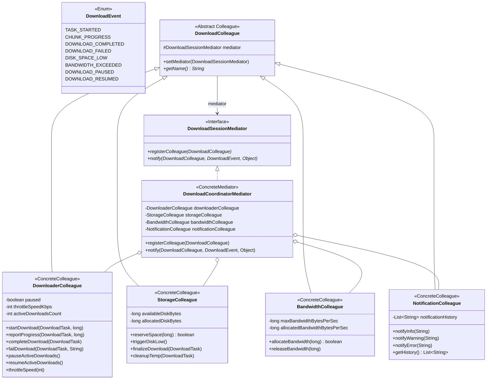

# Патерн Mediator (Посередник) у NetRetriever

Головна ідея патерну **Mediator** — **інкапсулювати спосіб взаємодії множини об'єктів (колег) в одному об'єкті-посереднику**, зменшуючи взаємну зв'язність і дозволяючи змінювати логіку взаємодії незалежно від самих компонентів.

---

### 1. Проблема без патерну

Під час виконання сесій завантаження взаємодіє кілька незалежних підсистем:
* **Мережевий рушій (Downloader):** починає передачу байтів, звітує прогрес, завершує або фіксує збій завантаження.
* **Файлове сховище (Storage):** перевіряє вільне місце на диску, резервує простір, переміщує тимчасові файли та очищує сміття у разі збоїв.
* **Менеджер трафіку (Bandwidth QoS):** виділяє швидкість каналу, фіксує перевантаження мережі та обмежує споживання трафіку.
* **Сервіс сповіщень (Notifications):** відправляє системні та UI-сповіщення (успіх, прогрес, попередження, критичні помилки).

Якщо ці підсистеми взаємодіють напряму (many-to-many), виникає **спагеті-залежність**:
* Рушій завантаження мусить мати прямі посилання на файлове сховище, контролер трафіку та UI сповіщень.
* Файлове сховище при браку місця змушене знати про рушій завантаження, щоб його призупинити.
* Зміна або тестування будь-якого компонента вимагає ініціалізації всього клубка залежностей.

---

### 2. Архітектурне рішення з патерном Mediator

Посередник [`DownloadCoordinatorMediator`](./DownloadCoordinatorMediator.java) централізує всі комунікації. Колеги взаємодіють виключно з посередником через єдиний метод `notify(sender, event, data)`:



---

### 3. Структура класів

* [`DownloadSessionMediator`](./DownloadSessionMediator.java) — інтерфейс посередника, що задає реєстрацію та обробку подій колег.
* [`DownloadEvent`](./DownloadEvent.java) — перелік доменних подій життєвого циклу завантаження.
* [`DownloadColleague`](./DownloadColleague.java) — абстрактний базовий клас учасника взаємодії.
* **Конкретні колеги:**
  * [`DownloaderColleague`](./DownloaderColleague.java) — ініціює події завантаження; реагує на команди призупинення та дроселювання швидкості (throttling).
  * [`StorageColleague`](./StorageColleague.java) — резервує місце на диску, ініціює подію `DISK_SPACE_LOW`, переміщує готові файли або видаляє тимчасові файли.
  * [`BandwidthColleague`](./BandwidthColleague.java) — веде облік споживаної смуги пропускання, ініціює `BANDWIDTH_EXCEEDED`.
  * [`NotificationColleague`](./NotificationColleague.java) — отримує повідомлення від посередника та фіксує історію сповіщень.
* [`DownloadCoordinatorMediator`](./DownloadCoordinatorMediator.java) — конкретний посередник, що зв'язує докупи всі 4 колеги і реагує на події.

---

### 4. Приклад використання

```java
// Створення колег
DownloaderColleague downloader = new DownloaderColleague();
StorageColleague storage = new StorageColleague(50_000_000_000L, 5_000_000_000L); // 50 GB free, 5 GB warning
BandwidthColleague bandwidth = new BandwidthColleague(10_485_760L); // 10 MB/s ceiling
NotificationColleague notifications = new NotificationColleague();

// Створення та конфігурація посередника
DownloadCoordinatorMediator mediator = new DownloadCoordinatorMediator(
        downloader, storage, bandwidth, notifications
);

// 1. Початок завантаження (Downloader повідомляє Mediator -> Mediator резервує диск, виділяє смугу, сповіщає користувача)
DownloadTask task = new DownloadTask("https://example.org/ubuntu.iso", "ubuntu.iso", "/downloads");
downloader.startDownload(task, 4_000_000_000L);

// 2. У разі вичерпання диска Storage сигналізує DISK_SPACE_LOW -> Mediator зупиняє Downloader і шле Warning
storage.triggerDiskLow();
// downloader.isPaused() == true

// 3. Завершення завантаження -> Mediator звільняє ресурси трафіку, фіналізує файл на диску, сповіщає UI
downloader.completeDownload(task);
```

---

### 5. Відповідність принципам архітектури

* **Loose Coupling (Слабке зв'язування):** Жоден із колег не посилається на іншого безпосередньо. Заміна чи переписування алгоритму дискового сховища не впливає на мережевий рушій.
* **Single Responsibility Principle (SRP):** Колеги відповідають суто за власні предметні області; логіка координації та взаємодії повністю винесена в посередника.
* **Indirection (GRASP):** Посередник діє як проміжний вузол зв'язку між клієнтськими підсистемами.
* **Open/Closed Principle (OCP):** Нові колеги (наприклад, `AntivirusScannerColleague`) додаються без переписування наявних колег.
