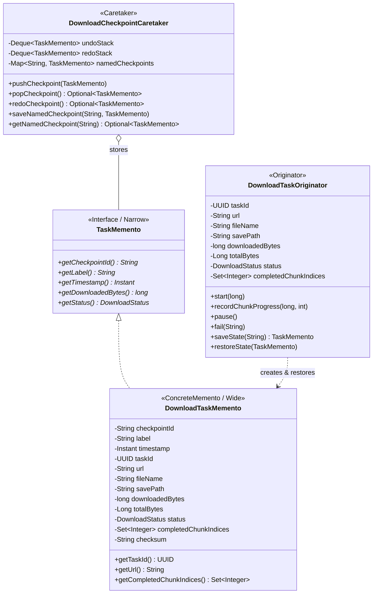

# Патерн Memento (Знімок / Хранитель) у NetRetriever

Головна ідея патерну **Memento** — **не порушуючи інкапсуляції, зафіксувати та зберегти внутрішній стан об'єкта так, щоб згодом цей стан можна було повністю відновити**.

---

### 1. Проблема без патерну

Під час довготривалого мережевого завантаження великих файлів (багатогігабайтні образи, архіви даних) часто виникають непередбачувані ситуації:
* **Мережеві збої та таймаути:** зв'язок обривається, і частково завантажений файл опиняється у невизначеному стані.
* **Необхідність контрольних точок (Checkpoints):** створення знімків прогресу (наприклад, кожні 10% або перед небезпечними операціями).
* **Порушення інкапсуляції:** якщо сторонній клас (сервіс відновлення або Caretaker) для збереження стану вичитує всі внутрішні поля завдання (`downloadedBytes`, `status`, список завантажених чанків, тимчасові шляхи), це розкриває деталі реалізації і робить код вразливим до змін.

---

### 2. Архітектурне рішення з патерном Memento

Патерн вирішує проблему за допомогою розділення інтерфейсу знімка на **вузький (Narrow Interface)** та **широкий (Wide Interface)**:
1. **Originator ([`DownloadTaskOriginator`](./DownloadTaskOriginator.java)):** володіє повним доступом до внутрішнього стану, створює екземпляр знімка [`DownloadTaskMemento`](./DownloadTaskMemento.java) та відновлює свій стан із нього.
2. **Memento ([`TaskMemento`](./TaskMemento.java) / [`DownloadTaskMemento`](./DownloadTaskMemento.java)):** незмінний (immutable) об'єкт, що зберігає точну копію стану. Для опікуна (Caretaker) надає лише вузький інтерфейс (метадані, мітку, мітку часу), захищаючи внутрішні поля.
3. **Caretaker ([`DownloadCheckpointCaretaker`](./DownloadCheckpointCaretaker.java)):** опікується збереженням знімків у стеку контрольних точок (Undo/Redo) або за іменованими мітками, ніколи не модифікуючи і не аналізуючи нутрощі знімка.



---

### 3. Структура класів

* [`TaskMemento`](./TaskMemento.java) — вузький інтерфейс знімка для опікуна (`checkpointId`, `label`, `timestamp`, `downloadedBytes`, `status`).
* [`DownloadTaskMemento`](./DownloadTaskMemento.java) — незмінний конкретний знімок, що виконує глибоке копіювання списку завершених чанків та стану.
* [`DownloadTaskOriginator`](./DownloadTaskOriginator.java) — творець стану (Originator), що веде облік завантаження і вміє фіксувати/відкочувати стан (`saveState()`, `restoreState()`).
* [`DownloadCheckpointCaretaker`](./DownloadCheckpointCaretaker.java) — зберігач знімків із підтримкою LIFO стека відкатів (Undo/Redo) та іменованих контрольних точок.

---

### 4. Приклад використання

```java
DownloadTaskOriginator originator = new DownloadTaskOriginator("https://example.org/ubuntu.iso", "ubuntu.iso", "/downloads");
DownloadCheckpointCaretaker caretaker = new DownloadCheckpointCaretaker();

originator.start(4_000_000_000L); // 4 GB
originator.recordChunkProgress(1_000_000_000L, 0); // 1 GB, chunk 0

// Створення контрольної точки
TaskMemento checkpoint1 = originator.saveState("25%-progress");
caretaker.pushCheckpoint(checkpoint1);

// Продовження завантаження
originator.recordChunkProgress(2_000_000_000L, 1); // 2 GB, chunk 1

// Непередбачуваний мережевий збій
originator.fail("Network packet drop");

// Відновлення до контрольної точки за допомогою Caretaker
caretaker.popCheckpoint().ifPresent(originator::restoreState);

System.out.println("Відновлений статус: " + originator.getStatus()); // DOWNLOADING
System.out.println("Відновлені байти: " + originator.getDownloadedBytes()); // 1_000_000_000
```

---

### 5. Відповідність принципам архітектури

* **Encapsulation (Інкапсуляція):** Стан об'єкта доступний лише Originator'у. Caretaker оперує знімками як «чорними скриньками».
* **Single Responsibility Principle (SRP):** Originator відповідає за виконання завантаження, Memento — за незмінне збереження даних, а Caretaker — за історію та життєвий цикл контрольних точок.
* **Information Expert (GRASP):** Тільки Originator володіє всіма даними для точного відновлення своєї структури (зокрема множини завантажених чанків).
