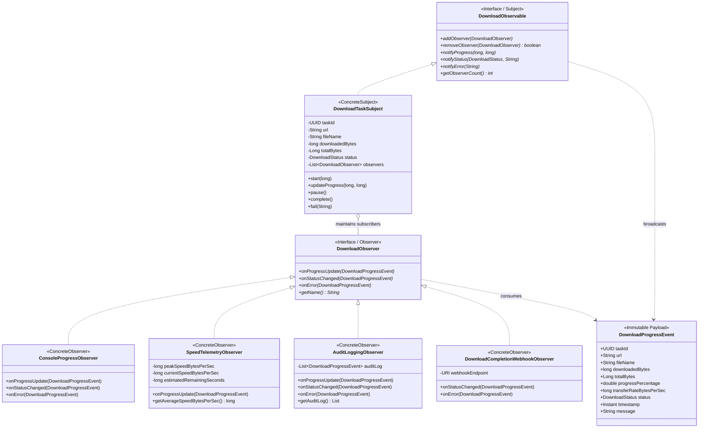

# Патерн Observer (Спостерігач) у NetRetriever

Головна ідея патерну **Observer** — **визначити залежність типу «один-до-багатьох» між об'єктами так, що при зміні стану одного об'єкта всі залежні від нього об'єкти автоматично сповіщаються та оновлюються**.

---

### 1. Проблема без патерну

Під час активного мережевого завантаження безліч підсистем потребують актуальної інформації про його стан:
* **Термінальний інтерфейс / UI:** потребує даних для візуалізації progress bar'а та поточних відсотків.
* **Аналізатор пропускної здатності (Telemetry):** розраховує середню швидкість передачі, пікове навантаження та приблизний час до завершення (ETA).
* **Системний журнал (Audit Logger):** фіксує переходи станів для аудиту та налагодження.
* **Зовнішні інтеграції (Webhooks / Push Alerts):** повідомляють сторонні сервіси про завершення завантаження або критичні помилки.

Якщо суб'єкт завантаження безпосередньо викликає кожен із цих модулів:
1. Виникає сильне зв'язування (**Tight Coupling**): завантажувач залежить від консолі, логера, мережевих вебхуків тощо.
2. Порушується принцип відкритості/закритості (**OCP**): щоб додати нового спостерігача (наприклад, звуковий сигнал або пуш-сповіщення), доведеться модифікувати код самого завантажувача.
3. Унеможливлюється динамічне підключення/відключення слухачів у рантаймі.

---

### 2. Архітектурне рішення з патерном Observer

Суб'єкт завантаження [`DownloadTaskSubject`](./DownloadTaskSubject.java) реалізує інтерфейс [`DownloadObservable`](./DownloadObservable.java), керуючи списком підписників [`DownloadObserver`](./DownloadObserver.java). При виникненні подій суб'єкт розсилає незмінний об'єкт [`DownloadProgressEvent`](./DownloadProgressEvent.java):



---

### 3. Структура класів

* [`DownloadObservable`](./DownloadObservable.java) — інтерфейс суб'єкта для керування підписками та розсилки подій.
* [`DownloadObserver`](./DownloadObserver.java) — загальний контракт для всіх спостерігачів.
* [`DownloadProgressEvent`](./DownloadProgressEvent.java) — незмінний об'єкт події з деталями передачі байтів, відсотками та швидкістю.
* [`DownloadTaskSubject`](./DownloadTaskSubject.java) — конкретний суб'єкт, що транслює стан завдання.
* **Конкретні спостерігачі:**
  * [`ConsoleProgressObserver`](./ConsoleProgressObserver.java) — малює текстовий прогрес-бар та швидкість у терміналі.
  * [`SpeedTelemetryObserver`](./SpeedTelemetryObserver.java) — розраховує пікову швидкість, ковзну середню та залишковий час (ETA).
  * [`AuditLoggingObserver`](./AuditLoggingObserver.java) — фіксує хронологічний журнал усіх подій для аудиту.
  * [`DownloadCompletionWebhookObserver`](./DownloadCompletionWebhookObserver.java) — відправляє зовнішній HTTP-запит при досягненні фінального статусу (`COMPLETED` або `ERROR`).

---

### 4. Приклад використання

```java
DownloadTaskSubject taskSubject = new DownloadTaskSubject(
        "https://releases.ubuntu.com/ubuntu-24.04.iso", "ubuntu.iso", "/downloads"
);

// Підключення спостерігачів
taskSubject.addObserver(new ConsoleProgressObserver());
taskSubject.addObserver(new SpeedTelemetryObserver());
taskSubject.addObserver(new AuditLoggingObserver());
taskSubject.addObserver(new DownloadCompletionWebhookObserver(URI.create("https://webhook.internal/downloads")));

// Запуск та потік байтів
taskSubject.start(4_000_000_000L); // 4 GB
taskSubject.updateProgress(1_000_000_000L, 50_000_000L); // 1 GB @ 50 MB/s
taskSubject.updateProgress(2_500_000_000L, 60_000_000L); // 2.5 GB @ 60 MB/s
taskSubject.complete(); // Завершення -> Webhook відправлено, аудит зафіксовано
```

---

### 5. Відповідність принципам архітектури

* **Open/Closed Principle (OCP):** Нові спостерігачі (наприклад, надсилання SMS, збереження в БД) додаються без будь-яких змін у коді `DownloadTaskSubject`.
* **Single Responsibility Principle (SRP):** Суб'єкт відповідає лише за передачу даних; кожен спостерігач вирішує одну конкретну задачу (відображення, розрахунок швидкості, журналювання).
* **Dependency Inversion Principle (DIP):** Суб'єкт залежить виключно від абстрактного інтерфейсу `DownloadObserver`.
* **Low Coupling (GRASP):** Суб'єкт не знає конкретних класів слухачів, що забезпечує максимальну модульність.
