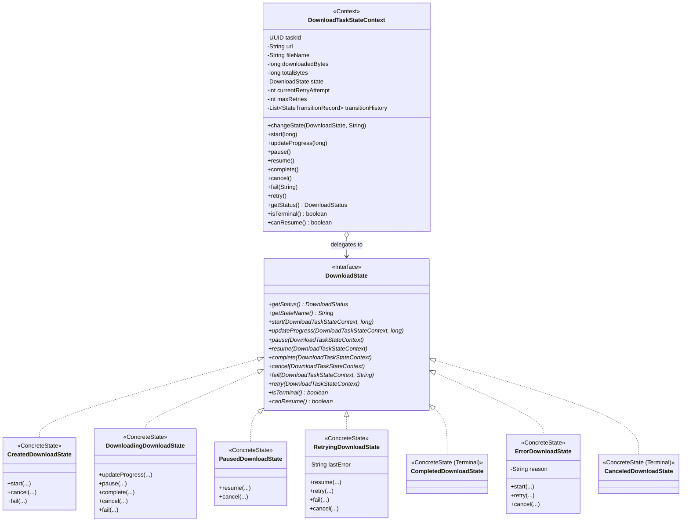
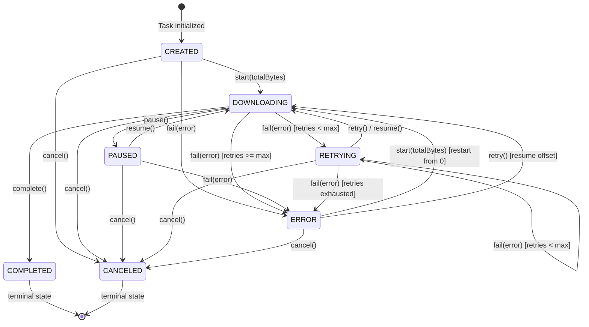

# Патерн State (Стан) у NetRetriever

Головна ідея патерну **State** — **дозволити об'єкту змінювати свою поведінку при зміні його внутрішнього стану**. Створюється враження, що об'єкт змінив свій клас.

---

### 1. Проблема без патерну

У менеджері мережевих завантажень доменна сутність ([`DownloadTask`](../../../downloadtask/DownloadTask.java)) проходить через складний життєвий цикл станів: `CREATED` $\to$ `DOWNLOADING` $\rightleftarrows$ `PAUSED` $\to$ `COMPLETED`, або аварійні переходи у `ERROR` чи `CANCELED` з підтримкою повторів (`RETRYING`).

Без патерну State життєвий цикл реалізується за допомогою розгалужених умовних операторів (`if-else` або `switch-case`):
```java
public void updateProgress(long bytes) {
    if (this.status != DownloadStatus.DOWNLOADING) {
        throw new IllegalStateException("Cannot update progress while status is " + this.status);
    }
    // ...
}

public void pause() {
    if (this.status != DownloadStatus.DOWNLOADING) {
        throw new IllegalStateException("Cannot pause task from status: " + this.status);
    }
    this.status = DownloadStatus.PAUSED;
}
```

Недоліки такого підходу:
1. **Порушення Single Responsibility Principle (SRP):** Клас завантажувача перевантажений логікою перевірок валідності переходів для кожного стану.
2. **Порушення Open/Closed Principle (OCP):** Додавання нового проміжного або відновлюваного стану (наприклад, `RETRYING` з експоненційним backoff) вимагає модифікації кожного окремого методу життєвого циклу (`start`, `pause`, `resume`, `complete`, `fail`, `cancel`).
3. **Розкиданість коду та дублювання перевірок:** Стан перетворюється на звичайний `enum`, а логіка його поведінки фрагментована по численних методах.
4. **Складність тестування:** Неможливо протестувати поведінку конкретного стану в ізоляції від усієї доменної моделі.

---

### 2. Архітектурне рішення з патерном State

Патерн State розділяє відповідальність між контекстом та сімейством класів станів:
* **State Interface:** [`DownloadState`](./DownloadState.java) оголошує уніфікований контракт для дій життєвого циклу завантаження (`start`, `updateProgress`, `pause`, `resume`, `complete`, `cancel`, `fail`, `retry`).
* **Context:** [`DownloadTaskStateContext`](./DownloadTaskStateContext.java) зберігає посилання на поточний активний стан (`DownloadState state`), лічильник спроб повтору (`retryCount`), накопичені байти та історію переходів ([`StateTransitionRecord`](./StateTransitionRecord.java)). Усі операції контекст делегує поточному стану.
* **Concrete States:**
  * [`CreatedDownloadState`](./CreatedDownloadState.java) — початковий стан, дозволяє тільки запуск або скасування.
  * [`DownloadingDownloadState`](./DownloadingDownloadState.java) — активне потокове зчитування мережевих байтів, валідація прогресу без регресії.
  * [`PausedDownloadState`](./PausedDownloadState.java) — призупинений стан зі збереженням накопичених байтів, підтримує відновлення (`resume()`).
  * [`RetryingDownloadState`](./RetryingDownloadState.java) — транзитний стан стійкості, що забезпечує автоматичне відновлення після збоїв зв'язку в межах ліміту спроб.
  * [`CompletedDownloadState`](./CompletedDownloadState.java) — термінальний успішний стан, забороняє будь-які подальші модифікації.
  * [`ErrorDownloadState`](./ErrorDownloadState.java) — нетермінальний стан помилки, що дозволяє перезапуск (`start()`) або ручний повтор (`retry()`).
  * [`CanceledDownloadState`](./CanceledDownloadState.java) — термінальний стан скасування.



---

### 3. Діаграма переходів станів (State Transition Lifecycle)



---

### 4. Приклад використання

```java
// Створення контексту завдання з лімітом у 2 спроби повтору
DownloadTaskStateContext context = new DownloadTaskStateContext(
        "https://releases.ubuntu.com/noble/ubuntu.iso",
        "ubuntu.iso",
        "/downloads/ubuntu.iso",
        2
);

// 1. Старт завантаження (CREATED -> DOWNLOADING)
context.start(1_000_000_000L); // 1 GB

// 2. Оновлення прогресу
context.updateProgress(250_000_000L);

// 3. Збій мережі з автоматичним переходом у RETRYING
context.fail("Connection reset by peer");
System.out.println(context.getStateName()); // "RETRYING"

// 4. Повторне з'єднання та успішне завершення
context.retry();
context.updateProgress(1_000_000_000L);
context.complete(); // DOWNLOADING -> COMPLETED

// 5. Перевірка історії переходів
for (StateTransitionRecord record : context.getTransitionHistory()) {
    System.out.printf("%s -> %s: %s%n", record.fromStatus(), record.toStatus(), record.reason());
}
```

---

### 5. Переваги та компроміси

| Переваги | Компроміси |
| :--- | :--- |
| **Локалізація поведінки:** Логіка для кожного стану зібрана в одному класі. | **Збільшення кількості класів:** Кожен стан вимагає окремого Java-файлу. |
| **Усунення величезних розгалужень:** Відсутні монструозні `switch`/`if-else` конструкції в контексті. | **Зв'язаність станів:** Якщо стани самостійно створюють наступні стани, вони знають про конкретні класи інших станів. |
| **Безпека переходів:** Неможливо випадково викликати метод у неприпустимому стані — генерується чітке виключення. | |
| **Простота розширення:** Новий стан (наприклад, `QUEUED` чи `VERIFYING_CHECKSUM`) додається без правки існуючих станів. | |
