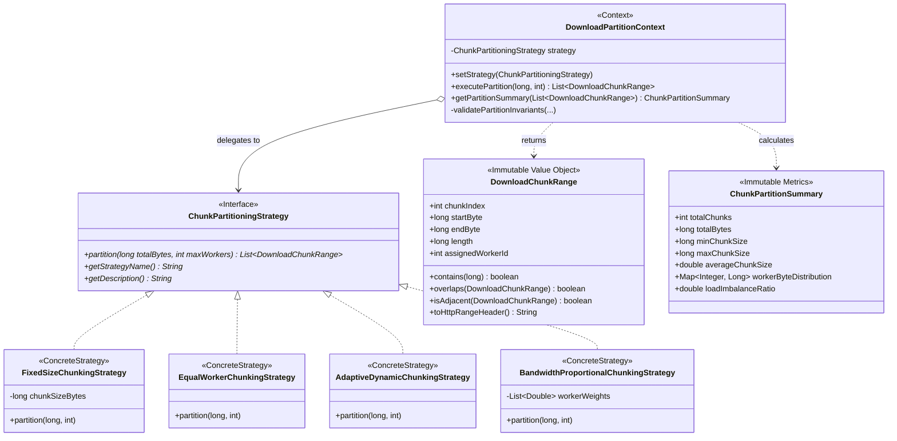

# Патерн Strategy (Стратегія) у NetRetriever

Головна ідея патерну **Strategy** — **визначити сімейство алгоритмів, інкапсулювати кожен із них і зробити їх взаємозамінними**. Стратегія дозволяє алгоритму змінюватися незалежно від клієнтів, які його використовують.

---

### 1. Проблема без патерну

У сучасних багатопотокових менеджерах завантажень (таких як IDM, aria2 чи NetRetriever) завантаження великих файлів здійснюється шляхом розбиття цільового файлу на фрагменти (chunks) для паралельного викачування через HTTP Range-запити (`Range: bytes=start-end`):
1. **Жорстке кодування алгоритму:** Якщо розбиття файлу на блоки зашито безпосередньо в логіку завантажувача (наприклад, просте ділення `totalBytes / workerCount`), система не може адаптуватися під специфіку різних сценаріїв (малі файли, дискове блочне кешування, різні швидкості серверних дзеркал).
2. **Проблема відстаючого потоку (Straggler / Bottleneck Problem):** Якщо всім з'єднанням виділяються однакові діапазони байтів, але одне дзеркало працює зі швидкістю 100 МБ/с, а інше — 10 МБ/с, швидке з'єднання швидко завершить роботу і простоюватиме, тоді як загальний час завантаження залежатиме від найповільнішого каналу.
3. **Накладні витрати на малі файли:** Розбиття файлу розміром 2 МБ на 16 потоків призводить до 16 TCP/TLS рукостискань, що суттєво уповільнює процес порівняно з послідовним завантаженням.
4. **Порушення Open/Closed Principle (OCP):** Додавання нової евристики розбиття потребує переписування коду координатора завантажень.

---

### 2. Архітектурне рішення з патерном Strategy

Патерн Strategy розділяє процес розбиття на взаємозамінні алгоритми:
* **Strategy Interface:** [`ChunkPartitioningStrategy`](./ChunkPartitioningStrategy.java) оголошує єдиний контракт `partition(totalBytes, maxWorkers)`.
* **Value Object:** [`DownloadChunkRange`](./DownloadChunkRange.java) — незмінний об'єкт діапазону байтів (`[startByte, endByte]`, довжина, номер воркера, генерація HTTP заголовка `bytes=X-Y`).
* **Context:** [`DownloadPartitionContext`](./DownloadPartitionContext.java) зберігає поточну стратегію, дозволяє динамічно перемикати її під час виконання (`setStrategy(...)`) та перевіряє суворі математичні інваріанти розбиття (відсутність прогалин, відсутність накладання, 100% покриття `totalBytes`).
* **Concrete Strategies:**
  * [`FixedSizeChunkingStrategy`](./FixedSizeChunkingStrategy.java) — розбиває файл на блоки фіксованого розміру (наприклад, по 2 чи 4 МБ) з циклічним (round-robin) розподілом між потоками.
  * [`EqualWorkerChunkingStrategy`](./EqualWorkerChunkingStrategy.java) — порівну ділить файл між $W$ потоками зі збалансованим розподілом залишку (максимальна різниця між потоками не перевищує 1 байт).
  * [`AdaptiveDynamicChunkingStrategy`](./AdaptiveDynamicChunkingStrategy.java) — адаптує кількість фрагментів залежно від розміру файлу (файли $< 5$ МБ завантажуються в 1 потік, 5–50 МБ — 4 потоки, 50–500 МБ — 8 потоків, $> 500$ МБ — 16 потоків).
  * [`BandwidthProportionalChunkingStrategy`](./BandwidthProportionalChunkingStrategy.java) — розраховує розміри фрагментів пропорційно пропускній здатності каналів/дзеркал, що усуває проблему "повільного воркера".



---

### 3. Приклад використання

```java
// Ініціалізація контексту з початковою стратегією рівномірного розподілу
DownloadPartitionContext context = new DownloadPartitionContext(new EqualWorkerChunkingStrategy());

long fileSize = 100_000_000L; // 100 MB
int workers = 4;

// 1. Виконання розбиття на 4 воркери
List<DownloadChunkRange> equalChunks = context.executePartition(fileSize, workers);
// Результат: 4 частини по 25 МБ

// 2. Динамічне перемикання на стратегію пропорційної швидкості (Worker 0 втричі швидший за Worker 1)
context.setStrategy(new BandwidthProportionalChunkingStrategy(List.of(3.0, 1.0)));
List<DownloadChunkRange> proportionalChunks = context.executePartition(fileSize, 2);
// Результат: Worker 0 отримує 75 МБ, Worker 1 отримує 25 МБ

// 3. Перевірка метрик та дисбалансу
ChunkPartitionSummary summary = context.getPartitionSummary(proportionalChunks);
System.out.printf("Avg chunk size: %.2f MB, Imbalance ratio: %.2f%n",
        summary.averageChunkSize() / (1024.0 * 1024.0),
        summary.loadImbalanceRatio());
```

---

### 4. Порівняння стратегій

| Стратегія | Переваги | Сценарій використання |
| :--- | :--- | :--- |
| **FixedSizeChunking** | Оптимальна для блочного кешування на диску, передбачувані буфери пам'яті. | Стандартні завантаження з фіксованими блоками (наприклад, по 4 МБ). |
| **EqualWorkerChunking** | Мінімальна кількість запитів ($W$), ідеальний баланс навантаження при однакових каналах. | Однорідні паралельні HTTP Range запити. |
| **AdaptiveDynamicChunking** | Нульова конфігурація: самостійно вибирає 1, 4, 8 або 16 блоків за розміром файлу. | Загальний режим для файлів довільного розміру від КБ до десятків ГБ. |
| **BandwidthProportional** | Усуває простій швидких дзеркал, пропорційний розподіл за реальними виміряними швидкостями. | Дзеркала різної потужності або з'єднання з гетерогенною пропускною здатністю. |
