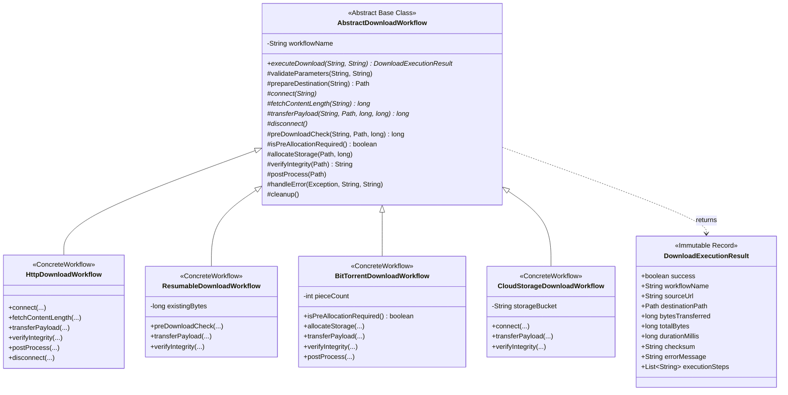
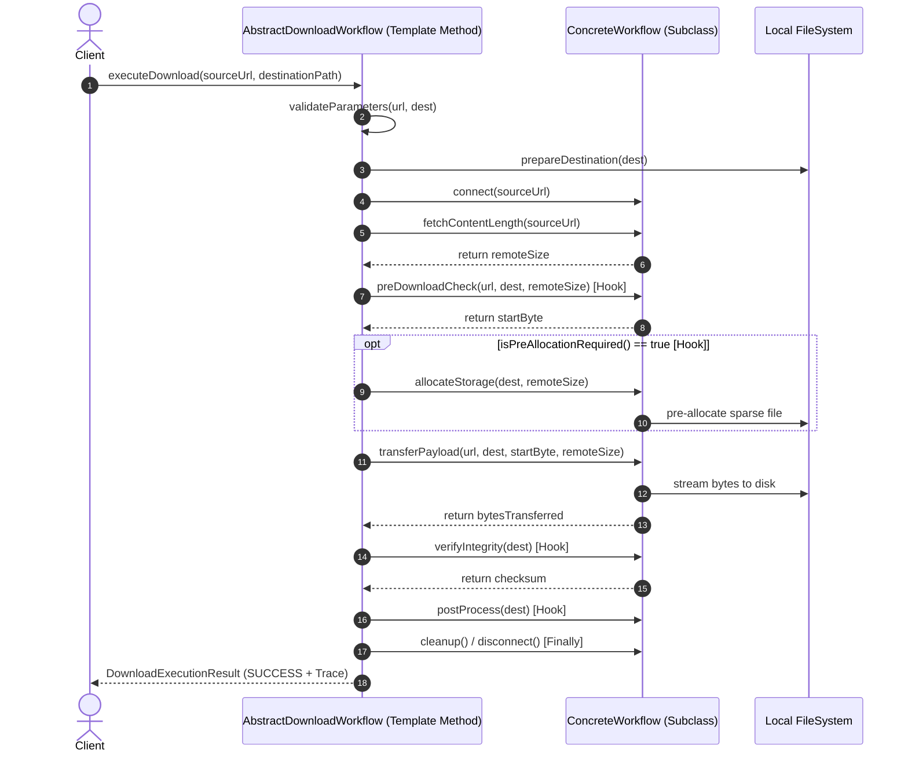

# Патерн Template Method (Шаблонний метод) у NetRetriever

Головна ідея патерну **Template Method** — **визначити кістяк (скелет) алгоритму в базовому класі, дозволяючи підкласам перевизначати окремі кроки алгоритму без зміни його загальної структури**.

Цей патерн реалізує фундаментальний принцип об'єктно-орієнтованого проектування — **Hollywood Principle** (*«Don't call us, we'll call you»*): базовий клас викликає методи підкласу, а не навпаки.

---

### 1. Проблема без патерну

У менеджері завантажень NetRetriever завантаження файлів з різних джерел (HTTP/2 потокове завантаження, відновлювані HTTP Range-запити, p2p-роздачі BitTorrent, об'єктні сховища AWS S3/GCP) концептуально мають спільний життєвий цикл:
1. Валідація вхідних параметрів.
2. Створення цільової локальної директорії.
3. Підключення до віддаленого сервера.
4. Отримання метаданих та розміру файлу.
5. Перевірка наявності частково завантаженого файлу.
6. Опціональне виділення місця на диску (pre-allocation).
7. Передача мережевих байтів.
8. Перевірка контрольної суми (SHA-256 / ETag / info-hash).
9. Пост-обробка (встановлення дозволів, антивірусне сканування).
10. Гарантоване звільнення мережевих сокетів та буферів пам'яті.

Якщо кожен протокольний завантажувач реалізує цей алгоритм самостійно:
* **Дублювання коду:** Кроки валідації, створення папок, обробки помилок та звільнення ресурсів дублюються у кожному класі.
* **Порушення порядку кроків:** Підклас може забути звільнити сокети в блоці `finally` або пропустити обов'язкову перевірку цілісності файлу.
* **Неможливість централізованого контролю:** Додавання глобального кроку (наприклад, аудиту чи безпекового сканування) вимагатиме ручної правки десятків незалежних класів.

---

### 2. Архітектурне рішення з патерном Template Method

Патерн вирішує проблему через чіткий розподіл відповідальності:
* **Abstract Base Class:** [`AbstractDownloadWorkflow`](./AbstractDownloadWorkflow.java) визначає незмінний шаблонний метод `executeDownload(...)` з модифікатором **`final`**, що унеможливлює його спотворення підкласами.
* **Primitive Abstract Steps:** Абстрактні кроки, які **зобов'язаний** реалізувати кожен протокольний завантажувач (`connect`, `fetchContentLength`, `transferPayload`, `disconnect`).
* **Hook Methods:** Методи-перехоплювачі зі стандартною або порожньою поведінкою за замовчуванням, які підкласи можуть перевизначати за необхідності (`preDownloadCheck`, `isPreAllocationRequired`, `allocateStorage`, `verifyIntegrity`, `postProcess`, `cleanup`).
* **Execution Result:** [`DownloadExecutionResult`](./DownloadExecutionResult.java) — незмінний звіт про виконання з трасуванням усіх пройдених кроків.



---

### 3. Діаграма послідовності кроків Template Method



---

### 4. Приклад використання

```java
// 1. Стандартне HTTP/HTTPS завантаження
AbstractDownloadWorkflow httpWorkflow = new HttpDownloadWorkflow();
DownloadExecutionResult httpResult = httpWorkflow.executeDownload(
        "https://cdn.example.org/releases/app.zip",
        "/downloads/app.zip"
);
System.out.printf("HTTP Transfer: %d bytes, Checksum: %s%n",
        httpResult.bytesTransferred(), httpResult.checksum());

// 2. Відновлюване завантаження з докачуванням відсутнього хвоста
AbstractDownloadWorkflow resumableWorkflow = new ResumableDownloadWorkflow(40_000_000L); // 40 MB вже є
DownloadExecutionResult resResult = resumableWorkflow.executeDownload(
        "https://cdn.example.org/big-file.iso",
        "/downloads/big-file.iso"
);
// Завантажено лише відсутні 60 MB із 100 MB

// 3. BitTorrent завантаження з попереднім виділенням дискового простору
AbstractDownloadWorkflow torrentWorkflow = new BitTorrentDownloadWorkflow(128);
DownloadExecutionResult torrentResult = torrentWorkflow.executeDownload(
        "magnet:?xt=urn:btih:ubuntu-24.04-iso",
        "/downloads/ubuntu.iso"
);
```

---

### 5. Переваги та компроміси

| Переваги | Компроміси |
| :--- | :--- |
| **Усунення дублювання:** Інваріантний алгоритм сконцентрований в єдиному місці. | **Обмеженість структури:** Якщо один із протоколів вимагає кардинально іншого порядку дій, шаблонний метод може стати перешкодою. |
| **Гарантія безпеки виконання:** Модифікатор `final` запобігає пропусканню обов'язкових кроків чи очищення в `finally`. | **Зростання кількості hook-методів:** Чим більше варіантів поведінки, тим більше перехоплювачів вимагає базовий клас. |
| **Інверсія управління (IoC):** Базовий клас викликає методи підкласу за потреби. | |
| **Простота додавання протоколів:** Новий протокол (WebRTC, SFTP) додається через реалізацію 4 базових примітивів. | |
