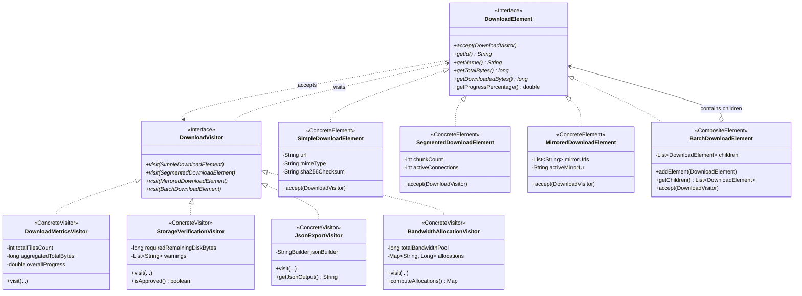
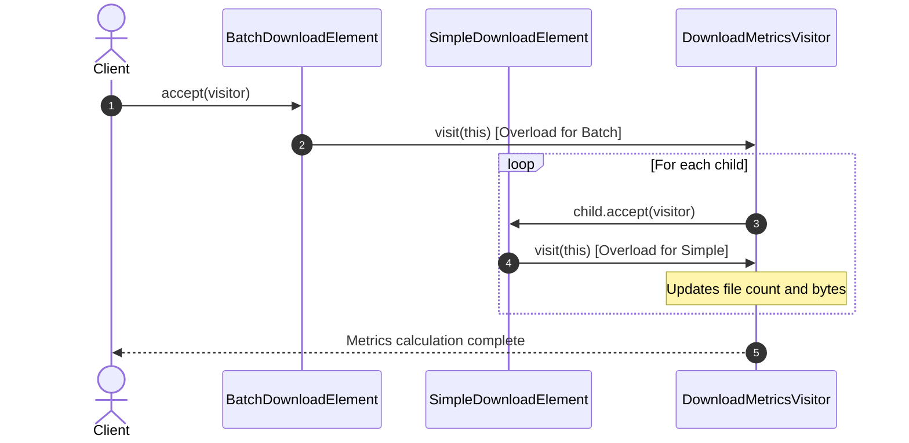

# Патерн Visitor (Відвідувач) у NetRetriever

Головна ідея патерну **Visitor** — **представити операцію, яка виконується над елементами складної об'єктної структури, у вигляді окремого класу**. Патерн дозволяє додавати нові операції над існуючими класами елементів, не змінюючи самі ці класи.

Реалізація спирається на механізм **подвійної диспетчеризації (Double Dispatch)**:
`element.accept(visitor)` $\to$ `visitor.visit(this)`.

---

### 1. Проблема без патерну

У NetRetriever завдання на завантаження утворюють складні ієрархічні та композитні структури:
* Прості поодинокі файли ([`SimpleDownloadElement`](./SimpleDownloadElement.java));
* Багатопотокові сегментовані завантаження ([`SegmentedDownloadElement`](./SegmentedDownloadElement.java));
* Дзеркальні завантаження з резервними URL ([`MirroredDownloadElement`](./MirroredDownloadElement.java));
* Композитні пакети та папки завантажень ([`BatchDownloadElement`](./BatchDownloadElement.java)).

Над цією структурою необхідно регулярно виконувати різноманітні операції:
1. **Підрахунок аналітики:** загальна кількість файлів, чанків, дзеркал, сумарний розмір і загальний відсоток прогресу.
2. **Перевірка безпеки та диска:** сумарний дельта-розмір для збереження на диску, виявлення дублікатів імен файлів, блокування небезпечних розширень (`.exe`, `.sh`) та незахищених протоколів (`http://`).
3. **Серіалізація / Експорт:** перетворення дерева завдань у структурований JSON для резервного копіювання чи REST API.
4. **QoS розподіл каналу:** розрахунок квот пропускної здатності (Bandwidth Allocation) між завданнями з урахуванням кількості активних потоків.

Якщо додавати кожен із цих методів безпосередньо в інтерфейс `DownloadElement` і кожен клас-елемент:
* **Порушення Single Responsibility Principle (SRP):** Класи завдань перетворюються на "God Objects", забруднені кодом JSON-серіалізації, безпековими евристиками та формулами QoS.
* **Порушення Open/Closed Principle (OCP):** Кожна нова операція (наприклад, експорт в XML чи експорт у Prometheus-метрики) вимагає редагування всіх класів структури.
* **Загроза дестабілізації:** Зміна формату JSON може ненавмисно порушити бізнес-логіку завантаження.

---

### 2. Архітектурне рішення з патерном Visitor

Патерн виносить усі операції в окремі класи відвідувачів:
* **Element Interface:** [`DownloadElement`](./DownloadElement.java) містить єдиний метод `void accept(DownloadVisitor visitor)`.
* **Visitor Interface:** [`DownloadVisitor`](./DownloadVisitor.java) містить перевантажені методи `visit(...)` для кожного конкретного типу елемента.
* **Concrete Elements:** [`SimpleDownloadElement`](./SimpleDownloadElement.java), [`SegmentedDownloadElement`](./SegmentedDownloadElement.java), [`MirroredDownloadElement`](./MirroredDownloadElement.java), [`BatchDownloadElement`](./BatchDownloadElement.java).
* **Concrete Visitors:**
  * [`DownloadMetricsVisitor`](./DownloadMetricsVisitor.java) — агрегація телеметрії та прогресу.
  * [`StorageVerificationVisitor`](./StorageVerificationVisitor.java) — аудит безпеки, перевірка місця та колізій імен.
  * [`JsonExportVisitor`](./JsonExportVisitor.java) — серіалізація структури у формат JSON.
  * [`BandwidthAllocationVisitor`](./BandwidthAllocationVisitor.java) — динамічний QoS розподіл пулу пропускної здатності.



---

### 3. Механізм Double Dispatch



---

### 4. Приклад використання

```java
// Створення композитного пакету
BatchDownloadElement batch = new BatchDownloadElement("Ubuntu-Release-Suite");

batch.addElement(new SimpleDownloadElement(
        "SHA256SUMS", "https://releases.ubuntu.com/noble/SHA256SUMS",
        5000L, 5000L, "text/plain", "sha256:sums-hash"
));

batch.addElement(new SegmentedDownloadElement(
        "ubuntu-server.iso", "https://releases.ubuntu.com/noble/ubuntu-server.iso",
        2_500_000_000L, 1_000_000_000L, 16, 4
));

batch.addElement(new MirroredDownloadElement(
        "ubuntu-desktop.iso", "https://primary.mirror.org/ubuntu-desktop.iso",
        List.of("https://backup1.org/iso", "https://backup2.org/iso"),
        5_000_000_000L, 2_500_000_000L
));

// 1. Агрегація метрик за допомогою DownloadMetricsVisitor
DownloadMetricsVisitor metricsVisitor = new DownloadMetricsVisitor();
batch.accept(metricsVisitor);
System.out.printf("Total files: %d, Progress: %.2f%%%n",
        metricsVisitor.getTotalFilesCount(), metricsVisitor.getOverallProgressPercentage());

// 2. Аудит безпеки та сховища за допомогою StorageVerificationVisitor
StorageVerificationVisitor securityVisitor = new StorageVerificationVisitor();
batch.accept(securityVisitor);
System.out.printf("Storage needed: %.2f GB, Approved: %b%n",
        securityVisitor.getRequiredRemainingDiskBytes() / (1024.0 * 1024.0 * 1024.0),
        securityVisitor.isApproved());

// 3. Експорт у формат JSON за допомогою JsonExportVisitor
JsonExportVisitor jsonVisitor = new JsonExportVisitor();
batch.accept(jsonVisitor);
System.out.println(jsonVisitor.getJsonOutput());

// 4. QoS розподіл 100 МБ/с каналу за допомогою BandwidthAllocationVisitor
BandwidthAllocationVisitor qosVisitor = new BandwidthAllocationVisitor(100_000_000L); // 100 MB/s
batch.accept(qosVisitor);
Map<String, Long> allocations = qosVisitor.computeAllocations();
```

---

### 5. Переваги та компроміси

| Переваги | Компроміси |
| :--- | :--- |
| **Open/Closed Principle:** Нова операція додається без зміни класів елементів. | **Складність додавання нових елементів:** Додавання нового типу елемента (`TorrentDownloadElement`) вимагає розширення інтерфейсу `DownloadVisitor` та оновлення всіх його реалізацій. |
| **Single Responsibility:** Пов'язана поведінка для операції зібрана в одному класі відвідувача. | **Порушення інкапсуляції (іноді):** Відвідувачам часто потрібен доступ до деталей внутрішнього стану елементів через геттери. |
| **Акумуляція стану:** Відвідувач може зберігати та накопичувати проміжний стан під час обходу складного дерева. | |
| **Подвійна диспетчеризація:** Точний вибір перевантаження на етапі компіляції без використання `instanceof`. | |
