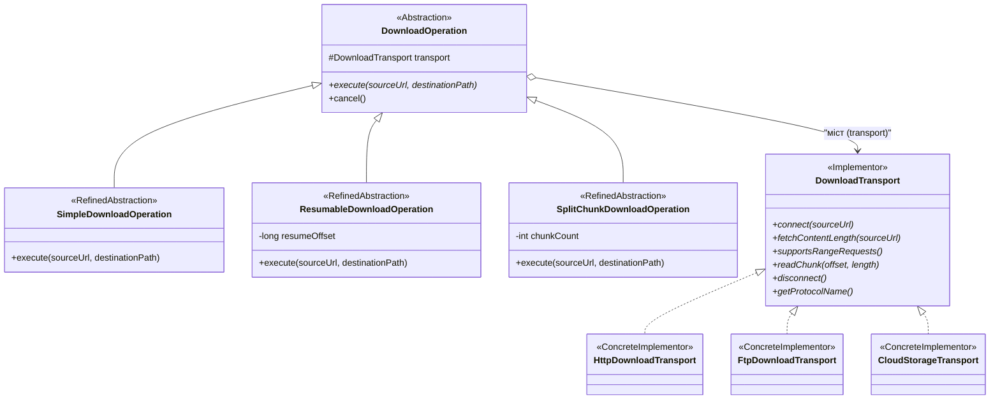

Головна ідея патерну **Bridge (Міст)** — **відокремити абстракцію від її реалізації так, щоб обидві частини могли змінюватися незалежно**, замінивши монолітне успадкування гнучкою композицією.

---

### 1. Проблема без патерну (Комбінаторний вибух $M \times N$)

У менеджері завантажень є два незалежні виміри:
1. **Як завантажувати** (алгоритм / бізнес-стратегія): просте послідовне завантаження, відновлення з місця зупинки (докачування), паралельне секційне завантаження частинами.
2. **Через який протокол завантажувати** (низькорівневий транспорт): HTTP, FTP, Cloud S3.

Якщо реалізовувати це класичним успадкуванням, виникає **комбінаторний вибух класів ($3 \times 3 = 9$)**:
`HttpSimpleDownload`, `FtpSimpleDownload`, `CloudSimpleDownload`, `HttpResumableDownload`, `FtpResumableDownload`, `CloudResumableDownload`, `HttpSplitChunkDownload`, `FtpSplitChunkDownload`, `CloudSplitChunkDownload`.

У разі додавання нового протоколу (наприклад, BitTorrent) довелося б створити ще 3 класи. При додаванні нового алгоритму — ще 3 класи.

---

### 2. Архітектурне рішення з патерном Bridge

Систему розділено на дві незалежні паралельні ієрархії, поєднані **мостом** (посиланням на інтерфейс через композицію):



#### Гілка 1. Абстракція (високорівнева логіка завантаження)
* **Базовий клас [`DownloadOperation`](./download_operation/DownloadOperation.java) (Abstraction)** інкапсулює міст:
  ```java
  protected final DownloadTransport transport;
  ```
* **Похідні класи (RefinedAbstraction)** визначають виключно алгоритм:
  * [`SimpleDownloadOperation`](./download_operation/SimpleDownloadOperation.java) — завантажує ресурс єдиним потоком.
  * [`ResumableDownloadOperation`](./download_operation/ResumableDownloadOperation.java) — перевіряє підтримку діапазонів і продовжує завантаження з `resumeOffset`.
  * [`SplitChunkDownloadOperation`](./download_operation/SplitChunkDownloadOperation.java) — розраховує діапазони, ділить файл на $N$ частин і виконує паралельне викачування частин.

#### Гілка 2. Реалізація (низькорівневі мережеві примітиви)
* **Інтерфейс [`DownloadTransport`](./download_transport/DownloadTransport.java) (Implementor)** визначає контракт низькорівневого каналу зв'язку (`connect`, `fetchContentLength`, `readChunk`, `disconnect`).
* **Конкретні реалізації (ConcreteImplementor)** відповідають суто за протокольні деталі:
  * [`HttpDownloadTransport`](./download_transport/HttpDownloadTransport.java) — HTTP HEAD/GET, заголовок `Range: bytes=start-end`.
  * [`FtpDownloadTransport`](./download_transport/FtpDownloadTransport.java) — FTP control channel, пасивний режим (PASV), команда `REST`.
  * [`CloudStorageTransport`](./download_transport/CloudStorageTransport.java) — S3/Blob REST API, AWS SigV4, multipart range GET.

---

### 3. Практичне застосування

У коді клієнта ([`StructuralPatternsDemo.java`](../StructuralPatternsDemo.java)) будь-яка операція динамічно конфігурується будь-яким транспортом під час виконання (runtime):

```java
// Багаточастинне секційне завантаження з хмари S3:
DownloadOperation op1 = new SplitChunkDownloadOperation(new CloudStorageTransport(), 4);
op1.execute("s3://bucket/data.bin", "/tmp/data.bin");

// Той самий алгоритм для роботи через HTTP без змін у логіці операції:
DownloadOperation op2 = new SplitChunkDownloadOperation(new HttpDownloadTransport(), 8);
op2.execute("https://site.org/data.bin", "/tmp/data.bin");
```

### Переваги
1. **Зниження складності:** Замість $M \times N$ класів ($3 \times 3 = 9$) маємо $M + N$ класів ($3 + 3 = 6$).
2. **Дотримання OCP та DIP:** Нові протоколи або нові алгоритми додаються незалежно один від одного, не змінюючи наявний код.
3. **Гнучкість у runtime:** Транспорт можна змінювати динамічно без перекомпіляції клієнтського коду.