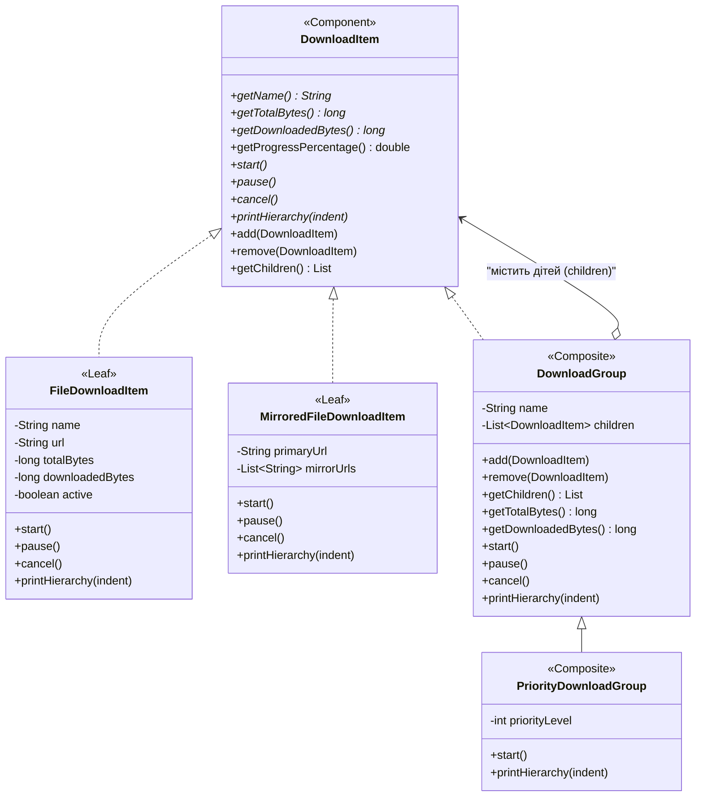

# Патерн Composite (Деревовидна структура / Компонувальник) у NetRetriever

Головна ідея патерну **Composite** — **об'єднати об'єкти в деревоподібну структуру для представлення ієрархій «частина-ціле»**, дозволяючи клієнтам однаково взаємодіяти як з окремими об'єктами, так і з групами об'єктів.

---

### 1. Проблема без патерну

У менеджері завантажень користувач може завантажувати:
* Окремий одиночний файл (`FileDownloadItem`).
* Пакет або папку з файлами (`DownloadGroup`), яка містить кілька файлів.
* Вкладені структури (наприклад, група «IDE & Tools», що містить групу «JDK 25», групу «Plugins» та окремий файл ліцензії).

Без патерну Composite клієнтському коду довелося б постійно перевіряти тип елемента (`instanceof`), вести окремі списки для файлів і папок та окремо реалізовувати рекурсивний підрахунок загального прогресу й розміру.

---

### 2. Архітектурне рішення з патерном Composite

Усі елементи деревоподібної структури реалізують єдиний інтерфейс [`DownloadItem`](./DownloadItem.java):



#### Ролі патерну:
1. **Component ([`DownloadItem`](./DownloadItem.java)):**
   * Задає спільний контракт для листя та композитів (`start()`, `pause()`, `cancel()`, `getTotalBytes()`, `getDownloadedBytes()`, `getProgressPercentage()`).
   * Надає дефолтну реалізацію для управління дочірніми елементами (`add`, `remove`, `getChildren`).
2. **Leaf ([`FileDownloadItem`](./FileDownloadItem.java), [`MirroredFileDownloadItem`](./MirroredFileDownloadItem.java)):**
   * Представляють неподільні кінцеві файли без нащадків.
3. **Composite ([`DownloadGroup`](./DownloadGroup.java), [`PriorityDownloadGroup`](./PriorityDownloadGroup.java)):**
   * Зберігають колекцію дочірніх компонентів (`List<DownloadItem>`).
   * Рекурсивно делегують виклики (`start()`, `pause()`, `cancel()`) усім вкладеним елементам і сумують обсяги даних (`getTotalBytes()`, `getDownloadedBytes()`).

---

### 3. Практичне застосування

Клієнт взаємодіє з усім деревом через єдиний інтерфейс [`DownloadItem`](./DownloadItem.java):

```java
// Створення листових файлів
DownloadItem file1 = new FileDownloadItem("jdk-linux.tar.gz", "https://jdk.java.net/25", 200_000_000L, 50_000_000L);
DownloadItem file2 = new FileDownloadItem("docs.zip", "https://jdk.java.net/docs", 50_000_000L, 25_000_000L);

// Створення підгрупи (Composite)
DownloadGroup javaGroup = new DownloadGroup("Java Development Kit");
javaGroup.add(file1);
javaGroup.add(file2);

// Створення головної групи проєктів (Root Composite)
PriorityDownloadGroup rootProject = new PriorityDownloadGroup("Developer Workstation Bundle", 1);
rootProject.add(javaGroup);
rootProject.add(new FileDownloadItem("docker-compose.yaml", "https://example.com/docker", 10_000L, 10_000L));

// Єдиний запуск усього дерева:
rootProject.start();

// Вивід ієрархічної структури в консоль:
rootProject.printHierarchy("");

// Автоматичний рекурсивний підрахунок прогресу та розміру:
System.out.println("Загальний розмір: " + rootProject.getTotalBytes() + " байт");
System.out.println("Загальний прогрес: " + String.format("%.2f%%", rootProject.getProgressPercentage()));
```

---

### 4. Архітектурні переваги (SOLID / GRASP)
* **Single Responsibility Principle (SRP):** Листки відповідають за конкретний файл, композити — за структуру та делегування.
* **Open/Closed Principle (OCP):** Можна додавати нові типи файлів або груп без модифікації наявних класів.
* **Liskov Substitution Principle (LSP):** Будь-який Composite чи Leaf можна передати туди, де очікується `DownloadItem`.
* **Polymorphism (GRASP):** Поліморфний розрахунок загального прогресу та запуск дерева замість розгалужених `if (item instanceof ...)`.
