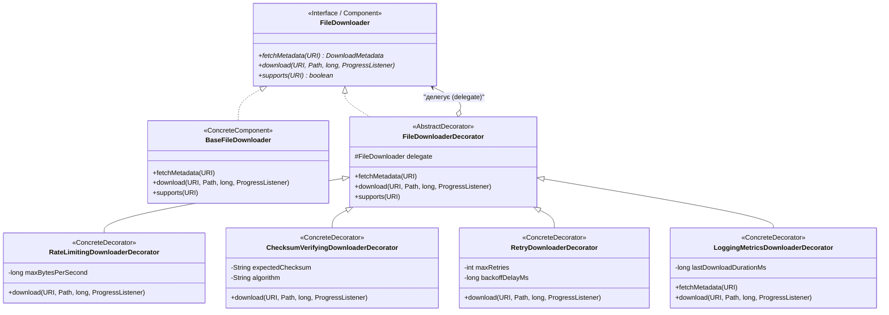

# Патерн Decorator (Декоратор) у NetRetriever

Головна ідея патерну **Decorator** — **динамічно додавати об'єкту нові обов'язки та поведінку без зміни його початкового коду**, надаючи гнучку альтернативу статичному підкласуванню (успадкуванню).

---

### 1. Проблема без патерну

У менеджері завантажень базовий процес завантаження файлів ([`FileDownloader`](../../../../downloader/FileDownloader.java)) часто потребує додаткових наскрізних функцій:
* Обмеження пропускної здатності (швидкості завантаження).
* Перевірка контрольної суми (SHA-256 / MD5).
* Автоматичні повторні спроби у разі мережевих збоїв (retry).
* Збір метрик та аудит тривалості операцій.

Якщо реалізовувати всі можливі комбінації через класичне успадкування, виникає **комбінаторний вибух класів**:
`ThrottledDownloader`, `VerifyingDownloader`, `RetryDownloader`, `ThrottledVerifyingDownloader`, `ThrottledRetryVerifyingDownloader`... Це робить кодову базу крихкою та монолітною.

---

### 2. Архітектурне рішення з патерном Decorator

Всі декоратори реалізують цільовий інтерфейс [`FileDownloader`](../../../../downloader/FileDownloader.java) та агрегують інший екземпляр `FileDownloader`, делегуючи йому базові виклики та додаючи власну поведінку:



#### Ролі патерну:
1. **Component ([`FileDownloader`](../../../../downloader/FileDownloader.java)):** Базовий контракт завантажувача файлів.
2. **ConcreteComponent ([`BaseFileDownloader`](./BaseFileDownloader.java)):** Базова реалізація мережевого завантаження.
3. **Decorator ([`FileDownloaderDecorator`](./FileDownloaderDecorator.java)):** Абстрактна обгортка, що зберігає посилання на `delegate`.
4. **ConcreteDecorators:**
   * [`RateLimitingDownloaderDecorator`](./RateLimitingDownloaderDecorator.java) — обмеження швидкості передачі даних.
   * [`ChecksumVerifyingDownloaderDecorator`](./ChecksumVerifyingDownloaderDecorator.java) — верифікація геш-суми файлу.
   * [`RetryDownloaderDecorator`](./RetryDownloaderDecorator.java) — автоматичний повтор операції при `IOException`.
   * [`LoggingMetricsDownloaderDecorator`](./LoggingMetricsDownloaderDecorator.java) — телеметрія та вимірювання часу виконання.

---

### 3. Практичне застосування та гнучкість ланцюжка

Клієнт може комбінувати декоратори у довільному порядку та кількості:

```java
// Базовий завантажувач
FileDownloader baseDownloader = new BaseFileDownloader();

// Збираємо довільний конвеєр поведінки через композицію
FileDownloader secureFastDownloader = new LoggingMetricsDownloaderDecorator(
    new RateLimitingDownloaderDecorator(
        new ChecksumVerifyingDownloaderDecorator(
            new RetryDownloaderDecorator(baseDownloader, 3, 200L),
            "e3b0c44298fc1c149afbf4c8996fb92427ae41e4649b934ca495991b7852b855",
            "SHA-256"
        ),
        10 * 1024 * 1024L // 10 МБ/с
    )
);

// Виклик виглядає для клієнта як звичайний FileDownloader
secureFastDownloader.download(
    URI.create("https://releases.ubuntu.com/noble/ubuntu.iso"),
    Path.of("/downloads/ubuntu.iso"),
    0L,
    progress -> System.out.println("Завантажено: " + progress)
);
```

---

### 4. Архітектурні переваги (SOLID / GRASP)
* **Single Responsibility Principle (SRP):** Кожен декоратор вирішує виключно одну задачу (retry, throttling, telemetry чи checksum).
* **Open/Closed Principle (OCP):** Додавання нового функціоналу (наприклад, шифрування AES) не вимагає модифікації наявних завантажувачів.
* **Liskov Substitution Principle (LSP):** Будь-який декорований об'єкт є повністю сумісним із контрактом `FileDownloader`.
* **Favor Object Composition over Class Inheritance:** Динамічне комбінування в runtime замість жорсткої ієрархії успадкування.
