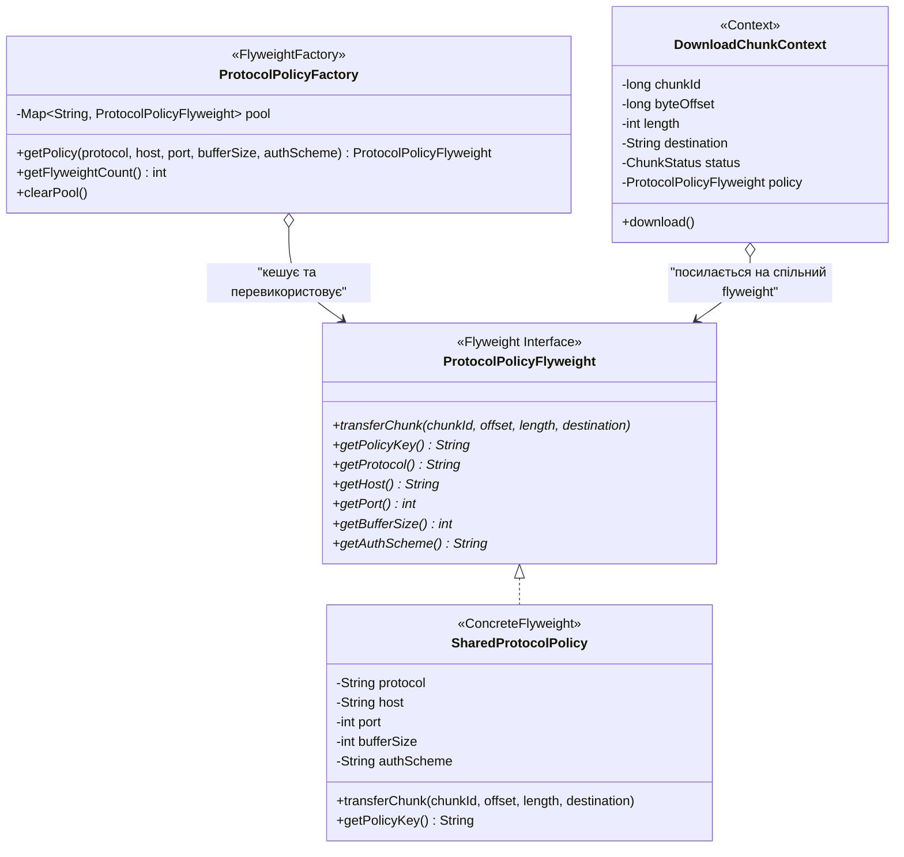

# Патерн Flyweight (Пристосуванець / Легковаговик) у NetRetriever

Головна ідея патерну **Flyweight** — **ефективно підтримувати роботу з величезною кількістю дрібних об'єктів за рахунок спільного використання (sharing) незмінного стану**, мінімізуючи споживання оперативної пам'яті.

---

### 1. Проблема без патерну (Пам'ять та GC Thrashing)

Уявімо завантаження великого файлу (наприклад, 100 ГБ), розбитого на **100 000 дрібних частин (chunks)**, або паралельне завантаження 50 000 файлів з одного CDN:
* Якщо кожен об'єкт `DownloadChunk` окремо зберігає протокол (`HTTPS`), хост (`cdn.example.org`), порт (`443`), розмір буфера (`64 КБ`), схему авторизації (`Bearer ...`) та заголовки — виникає величезна надлишковість даних у пам'яті.
* Створення 100 000 однакових рядків і конфігураційних об'єктів перевантажує купу (heap) і призводить до частих пауз Garbage Collector (GC thrashing).

---

### 2. Розділення стану: Intrinsic vs Extrinsic

Патерн Flyweight чітко розмежовує два види стану:

| Вид стану | Характеристика | Приклад у NetRetriever | Де зберігається |
| :--- | :--- | :--- | :--- |
| **Intrinsic (Внутрішній)** | Незмінний, спільний для багатьох об'єктів, не залежить від контексту конкретного чанка. | Протокол (`https`), хост (`cdn.mirror.com`), порт (`443`), розмір буфера (`65536`), схема автентифікації (`BEARER`). | Усередині об'єкта Flyweight ([`SharedProtocolPolicy`](./SharedProtocolPolicy.java)). |
| **Extrinsic (Зовнішній)** | Унікальний для кожного конкретного виклику чи об'єкта, змінюється динамічно. | Ідентифікатор чанка (`chunkId`), початкове зміщення (`byteOffset`), довжина (`length`), цільовий шлях (`destination`), статус (`PENDING`/`COMPLETED`). | У контексті клієнта ([`DownloadChunkContext`](./DownloadChunkContext.java)) або передається як аргументи методів. |

---

### 3. Архітектурне рішення з патерном Flyweight



#### Ролі патерну:
1. **Flyweight ([`ProtocolPolicyFlyweight`](./ProtocolPolicyFlyweight.java)):**
   * Визначає інтерфейс, через який пристосуванець приймає зовнішній стан (offset, length, destination) для виконання операції `transferChunk`.
2. **ConcreteFlyweight ([`SharedProtocolPolicy`](./SharedProtocolPolicy.java)):**
   * Зберігає внутрішній незмінний стан каналу зв'язку. Є повністю потокобезпечним та імутабельним.
3. **FlyweightFactory ([`ProtocolPolicyFactory`](./ProtocolPolicyFactory.java)):**
   * Створює та керує пулом спільних екземплярів пристосуванців. Гарантує, що для однакових параметрів завжди повертається один і той самий об'єкт із пулу.
4. **Context ([`DownloadChunkContext`](./DownloadChunkContext.java)):**
   * Зберігає зовнішній стан конкретного чанка та тримає посилання на спільний flyweight.

---

### 4. Практичне застосування

```java
ProtocolPolicyFactory factory = new ProtocolPolicyFactory();

// Отримуємо спільну політику для CDN (буде створено 1 екземпляр Flyweight)
ProtocolPolicyFlyweight cdnPolicy = factory.getPolicy("https", "cdn.fast-mirror.org", 443, 65536, "BEARER");

// Створюємо 10 000 чанків: усі вони посилаються на один і той самий екземпляр cdnPolicy!
List<DownloadChunkContext> chunks = new ArrayList<>();
long chunkSize = 1_048_576L; // 1 MB

for (int i = 0; i < 10_000; i++) {
    chunks.add(new DownloadChunkContext(i, i * chunkSize, (int) chunkSize, "/tmp/large.iso", cdnPolicy));
}

// Перевірка фабрики: у пулі лише 1 об'єкт замість 10 000 дублікатів конфігурацій
System.out.println("Кількість унікальних Flyweight у пулі: " + factory.getFlyweightCount()); // Виведе: 1

// Виконання передачі чанків:
chunks.get(0).download();
chunks.get(1).download();
```

---

### 5. Архітектурні переваги (SOLID / GRASP)
* **Single Responsibility Principle (SRP):** Flyweight відповідає суто за спільний мережевий протокол; Context — за параметри зміщення конкретного чанка; Factory — за життєвий цикл і кешування.
* **Information Expert (GRASP):** Контекст знає своє зміщення і довжину; Flyweight знає мережевий протокол і параметри сокета.
* **Pure Fabrication (GRASP):** `ProtocolPolicyFactory` створено спеціально для кешування та підтримки низької зв'язаності (Low Coupling).
* **Економія пам'яті:** Зниження навантаження на купу на порядок при масштабуванні до сотень тисяч одночасних сегментів завантаження.
