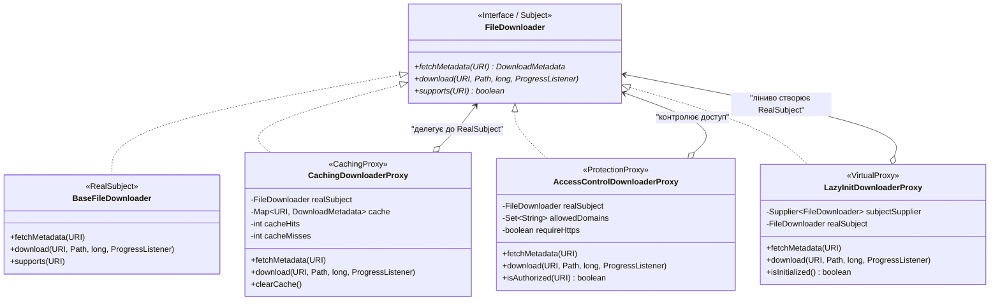

# Патерн Proxy (Замісник / Суррогат) у NetRetriever

Головна ідея патерну **Proxy** — **надати об'єкт-замінник, який контролює доступ до іншого цільового об'єкта (RealSubject)**, дозволяючи виконувати додаткові дії до або після передачі виклику (кешування, авторизація, лінива ініціалізація).

---

### 1. Проблема без патерну

У розподіленому завантажувачі пряме звернення клієнтів до реального компонента завантажувача має низку проблем:
1. **Повторні мережеві запити:** Клієнти або фонові планувальники можуть багаторазово запитувати метадані одного й того самого файлу (розмір, resumable-статус), генеруючи зайві мережеві RTT-затримки.
2. **Безпека та контроль доступу:** Необхідно блокувати завантаження з неперевірених доменів, заборонених зон або незахищених протоколів HTTP перед тим, як відкривати сокет.
3. **Ресурсомісткість створення клієнта:** Ініціалізація важких мережевих клієнтів (пули HTTP/2-з'єднань, TLS-сертифікати) може бути ресурсомісткою, коли користувач лише додає завдання у чергу без їх негайного старту.

---

### 2. Рішення з патерном Proxy

Замісник реалізує той самий інтерфейс [`FileDownloader`](../../../../downloader/FileDownloader.java), що й реальний об'єкт, виступаючи захисним або оптимізуючим прошарком:



---

### 3. Реалізовані різновиди замісників

У пакеті `proxy` представлено три канонічні різновиди патерну GoF Proxy:

1. **Кешуючий замісник ([`CachingDownloaderProxy`](./CachingDownloaderProxy.java)):**
   * Зберігає в кеші результати виклику `fetchMetadata(source)`.
   * При повторному запиті повертає дані миттєво без мережевого виклику (Cache HIT), заощаджуючи мережевий трафік.
2. **Захисний замісник ([`AccessControlDownloaderProxy`](./AccessControlDownloaderProxy.java)):**
   * Перевіряє дозволеність цільового домену за білим списком (whitelist) та вимагає безпечного протоколу HTTPS.
   * Викидає `SecurityException` у разі порушення правил безпеки до передачі виклику в RealSubject.
3. **Віртуальний замісник ([`LazyInitDownloaderProxy`](./LazyInitDownloaderProxy.java)):**
   * Відкладає створення та підключення важкого реального завантажувача до першого фактичного звернення через потокобезпечну подвійну перевірку блокування (`double-checked locking`).

---

### 4. Різниця між Proxy та Decorator

| Критерій | Decorator (Декоратор) | Proxy (Замісник) |
| :--- | :--- | :--- |
| **Головна мета** | **Розширення поведінки:** додавання нових обов'язків (ліміт швидкості, повторні спроби, гешування). | **Контроль доступу:** керування тим, *чи взагалі* і *коли* відбудеться звернення до реального об'єкта. |
| **Керування життєвим циклом** | Не керує створенням об'єкта — приймає вже готовий екземпляр у конструкторі. | Може самостійно створювати та контролювати життєвий цикл RealSubject (наприклад, Virtual Proxy). |
| **Композиція** | Декоратори зазвичай компонуються у багатошарові ланцюжки. | Замісник зазвичай стоїть як єдиний шлюз перед реальним об'єктом. |

---

### 5. Практичне застосування

```java
// 1. Створюємо захисний проксі з білим списком доменів
Set<String> allowedDomains = Set.of("kernel.org", "ubuntu.com");
FileDownloader accessProxy = new AccessControlDownloaderProxy(new BaseFileDownloader(), allowedDomains, true);

// 2. Огортаємо кешуючим проксі для збереження метаданих
FileDownloader cachedSecuredDownloader = new CachingDownloaderProxy(accessProxy);

URI validUri = URI.create("https://releases.ubuntu.com/noble/ubuntu.iso");

// Перший виклик: перевірка домену -> звернення до мережі (Cache MISS)
DownloadMetadata meta1 = cachedSecuredDownloader.fetchMetadata(validUri);

// Другий виклик: миттєва відповідь з пам'яті (Cache HIT) без повторної перевірки мережі
DownloadMetadata meta2 = cachedSecuredDownloader.fetchMetadata(validUri);

// Спроба доступу до неавторизованого домену:
URI blockedUri = URI.create("https://malicious-site.org/payload.exe");
// cachedSecuredDownloader.download(blockedUri, ...); // Викине SecurityException!
```

---

### 6. Архітектурні переваги (SOLID / GRASP)
* **Single Responsibility Principle (SRP):** RealSubject займається транспортом, а Proxy — контролем безпеки, кешуванням та оптимізацією.
* **Open/Closed Principle (OCP):** Нові правила доступу чи стратегії кешування додаються без модифікації основного клієнта.
* **Protected Variations (GRASP):** Зовнішній клієнт захищений від деталей авторизації та кешування, оскільки взаємодіє виключно через інтерфейс `FileDownloader`.
